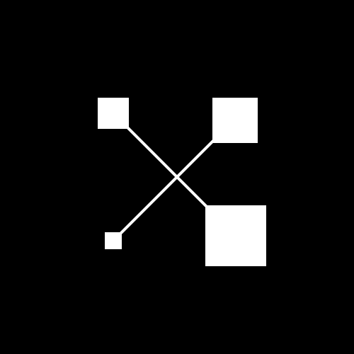

# Xolograph



**Open-source digital forensics and blockchain intelligence desktop application.**

Xolograph is a specialized, privacy-first desktop application designed for forensic analysts, threat researchers, and legal investigators to trace on-chain activity, cluster intelligence, and generate cryptographically verified chain-of-custody reports.

## Roadmap (see STATUS.md for verified progress)
- **Monochromatic UI Engine:** Strict data-centric visual language reducing cognitive load.
- **Persistent Case Management:** SQLite WAL-mode local storage ensuring privacy.
- **Evidence Vault:** SHA-256 chunked hashing for tamper-proof evidence ingestion.
- **Blockchain Data Layer:** Direct Ethereum JSON-RPC connectivity.
- **Activity Analytics:** Paginated transaction explorer with direction and asset filtering.
- **Interactive Graphing:** WebGL-accelerated (Sigma.js) node mapping and pathfinding.
- **Entity Intelligence:** Documented attribution provenance with confidence scoring.
- **Case Export Engine:** Comprehensive Markdown and JSON reporting with integrity checksums.

## Quick Start (Frontend Development)
```bash
cd frontend
npm install
npm run dev
```

## Production Build
```bash
# Build the React frontend
cd frontend && npm run build

# Compile the Go binaries & Tauri Shell
cd ../src-tauri && cargo build --release
```